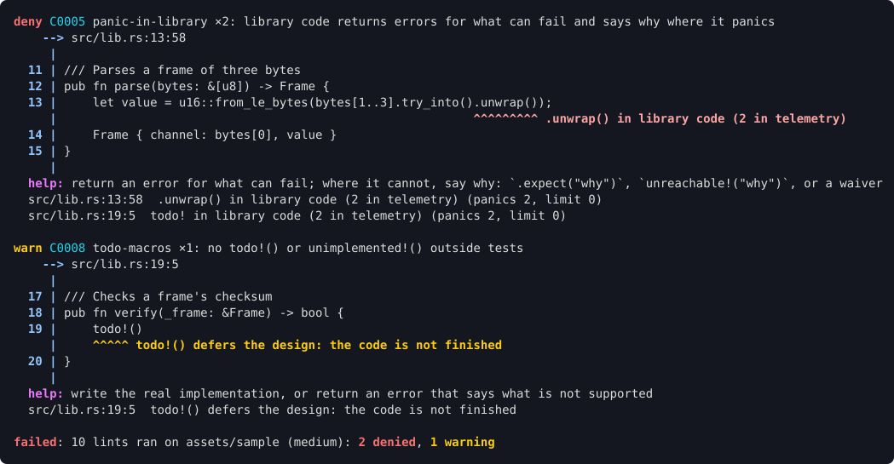

<p align="center">
  <picture>
    <source media="(prefers-color-scheme: dark)" srcset="assets/logo/spirit_level-dark.svg">
    
  </picture>
</p>

<p align="center"><b>The rules your Rust project wrote down, checked on every run.</b></p>

<p align="center">
  <a href="https://spl.vhrd.tech"></a>
  <a href="https://github.com/romixlab/spirit_level/actions/workflows/ci.yml"></a>
  <a href="#licence"></a>
  <a href="https://crates.io/crates/sl_board_model"></a>
  <a href="https://docs.rs/sl_board_model"></a>
  <a href="https://spl.vhrd.tech/tiers/big/"></a>
</p>

# spirit_level

spirit_level is a linter for Rust projects of every size, from one crate to a workspace of hundreds. Clippy checks your code line by line. spirit_level checks everything around it: how the workspace is put together, which crate may depend on which, how big things grow, how code shares state, what the docs read like, and whether the firmware fits its flash.

Every project has rules like "no `unwrap` in library code", "every crate inherits the workspace lints" or "the UI never blocks". They live in a wiki page or in someone's head, and they drift. spirit_level turns them into over 300 lints with codes, documented pages and exact fixes, and runs them in one command, `spl check`.

<p align="center"></p>

## Quick start

```bash
cargo install --locked --git https://github.com/romixlab/spirit_level spirit_level_cli
spl init --tier small-workspace   # writes spirit_level.toml
spl check                         # runs every lint the tier enables
spl check --fix                   # applies the exact fixes, then checks again
spl explain panic-in-library      # why a lint exists and how to fix a finding
```

## Tiers: start strict where it pays

A tier is a TOML file of lints with a level and a reason for each. The size tiers extend each other, so a project grows into stricter rules as it grows:

| Tier | For |
|---|---|
| `small` | one crate: metadata, docs, pure-Rust dependencies, build profiles, valid waivers |
| `small-workspace` | a few crates: shared package keys, lints and dependencies declared once at the root |
| `medium` | tens of crates: internal crates unpublished, MSRV declared, toolchain pinned |
| `big` | a crate map with layers checked edge by edge, size limits with expiring exceptions |

Topic tiers stack on top of a size tier with `extends = ["medium", "ai"]`:

| Tier | For |
|---|---|
| `ai` | code and docs written with agents: stop-gap comments, near-duplicate functions, committed transcripts and secrets |
| `embedded` | bare-metal firmware: interrupts, DMA, stack, flash, clocks, errata, USB, boot, power |
| `ui`, `egui` | user interfaces: theme colours, confirmed destructive actions, no blocking on the UI thread |

### Sets: one guard before the whole tier

Each size tier is built from sets, small groups of lints by what they guard. A tier extends the one below it and adds its sets; a guard's later lints sit in its `-strict` and `-paranoid` sets:

| Tier | Sets it adds |
|---|---|
| `small` | `panics`, `stop-gaps`, `unsafe`, `state`, `deps`, `docs`, `book`, `reading`, `prose`, `repo`, `manifest`, `cli`, `size`, `units` and more |
| `small-workspace` | `workspace`, `state-strict` |
| `medium` | `clippy-pedantic`, `panics-strict`, `msrv`, `licences`, `commits`, `tests`, `size-strict`, `structure`, `contracts` and more |
| `big` | `layers`, `api`, `determinism`, `deps-strict`, `panics-paranoid`, `stop-gaps-strict`, `contracts-strict` and more |

A project takes a set early by naming it beside its tier:

```toml
extends = ["small-workspace", "msrv", "clippy-pedantic"]
```

A set the tier already holds applies once, so naming it again never lowers a level. `spl tiers` lists every set with its lints; `units-strict` sits beside the tiers. The [sets page](https://spl.vhrd.tech/tiers/sets/) has each set's lints.

A workspace that mixes firmware with host tools puts the `embedded` tier on the firmware crates only.

## Exceptions carry a reason and an end date

A lint that does not fit is changed in `spirit_level.toml`, never silenced. Each change carries a reason, and it can carry an expiry, a date or a release. When the expiry passes, the run fails until someone fixes the cause or renews the exception with a new reason.

```toml
extends = ["big", "ai"]

[lints.duplicate-versions]
level = "allow"
reason = "syn 2 and 3 until clap moves"
expires = "2027-01-31"

[[exceptions]]
lint = "crate-lines"
crates = ["foo_sdk_types"]
max-lines = 120000
reason = "generated protocol types"
expires = "v0.5.0"
```

A single finding is waived where it is, with the reason next to the code:

```rust
let n = digits.parse::<u32>().unwrap(); // spirit-level: allow(panic-in-library) the lexer only yields digits
```

A waiver without a reason, or one that no longer allows anything, is a finding itself. Unknown keys, lint ids and tier names stop the run before any lint runs, so a typo cannot switch a check off.

## What it checks

| Group | Examples |
|---|---|
| Manifests | workspace inheritance, `[lints]`, dependency form, `-sys` crates with native builds, profiles, toolchain pin, repo files |
| Crate graph | declared layers edge by edge, forbidden closures, cycles, `_core` crates holding types only, the generated crate table |
| Size | god crates, modules and functions by code lines, cyclomatic complexity, a crate's biggest module cycle |
| Source | `todo!()`, panics and prints in library code, `#[allow]` without a reason, flat error enums, dead public items, float and hashing determinism |
| Shared state | `static mut`, statics with interior mutability, lock guards held across `.await` or I/O, nested locks |
| Prose and docs | CHANGELOG and commit limits, agent files, filler and narration, reading time, code walls, book navigation |
| CLIs | each binary's help, examples, completion, colour, version line and exit codes, from running it |
| Firmware | executors, interrupts, DMA, stack, memory, faults, clocks, errata, and every panic site in the linked ELF |
| Boards | `board.toml` against the chip's data and the PCB's nets, for every revision and rework |
| External tools | clippy, cargo-deny, cargo-audit, cargo-semver-checks, machete, shear, udeps, rustfmt, taplo, typos, geiger, hakari |

External tools report through the same engine, levels and waivers as the built-in lints. `spl tools needed` lists the ones a project's tiers use, and `just tools` installs the missing ones.

## Built for CI and agents

- **Exit codes:** 0 when nothing is denied, 1 for a denied finding, 2 for a configuration error, 3 when an enabled lint could not run. A check that skips part of its work never passes green.
- **JSON:** `spl check --format json` writes a stable document with every finding, its span, a fingerprint and its fix.
- **Stable names:** each lint has a kebab-case id and a code (`C0005`) that never changes. Both work in configuration, waivers and `--only`.
- **Deterministic:** dates come from `--today` or `SPIRIT_LEVEL_TODAY` in tests, and nothing reads the host's state.

## More commands

| Command | What it does |
|---|---|
| `spl config` | the resolved configuration: every level with the file that set it, every exception with its reason and expiry |
| `spl lints` | every lint with its level in each shipped tier |
| `spl dependents --base main` | the repos that build on this library and the crates in them to retest after a change |
| `spl pages` | reading metrics for every docs page: words, reading time, longest run of prose |
| `spl panics --elf <ELF>` | every panic site in a firmware release, with its function and task class |

## spirit_level checks itself

This repository runs `spl check` at the `big` tier as part of `just lint`. Its layers are declared in `spirit_level.toml`, its exceptions carry reasons, and its book is generated from the lints' own metadata. [ARCHITECTURE.md](ARCHITECTURE.md) shows the layers and every crate.

## Documentation

The book at [spl.vhrd.tech](https://spl.vhrd.tech), built from [`docs/`](docs/index.md), has one page per lint and per tier, generated from the code, and guides for [getting started](docs/start.md), [configuration](docs/configuration.md), [waivers](docs/waivers.md), [the crate map](docs/map.md) and [writing lints](docs/writing-lints.md). `just docs` serves it locally.

## Licence

MIT OR Apache-2.0. See [`CONTRIBUTING.md`](CONTRIBUTING.md).
