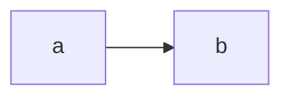

# Fx

word word word word word word word word word word.


word word word word word word word word word word.



word word word word word word word word word word.

<svg viewBox="0 0 10 10"><rect width="10" height="10"/></svg>

word word word word word word word word word word.

| A table is not a figure, its words are not prose |
|---|
| cell |

```sh
ls
```
