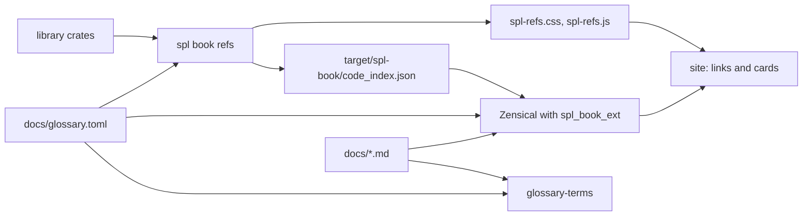
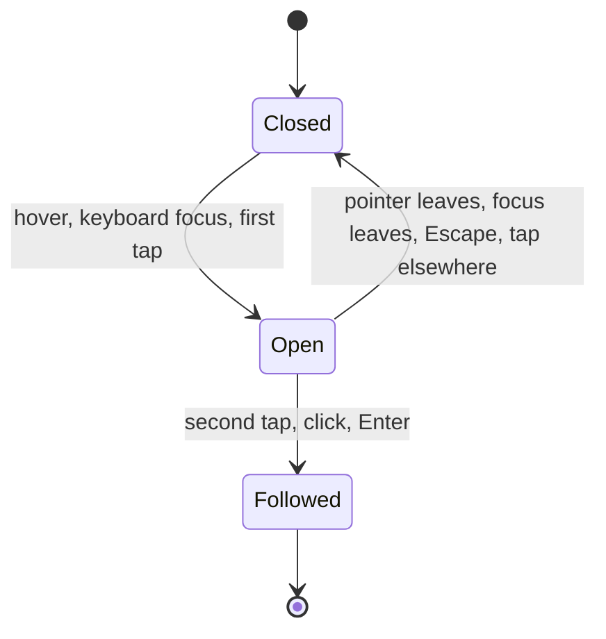

# References in prose

A book about code names two kinds of things in its prose: the terms it defines and the items of its code. With references, each becomes a link with a card that opens beside it.

| Written | Links to | Its card shows |
|---|---|---|
| `[[piece]]` | the term's entry on the glossary page | the one-sentence definition |
| ``[`TapeWriter::resume_on`]`` | the item's lines in the repository | kind, path, signature and docs |
| ``[`resume.rs`]``, ``[`crashes.rs:resume`]`` | the file's lines in the repository | the code of the file or of one marked section |

All are checked when the book builds. A term the glossary lacks, or an item, file or section that was renamed or removed, fails the build in the same change that breaks it. The error names the page and line of the reference.

## The parts

Three parts work together, and none of their output belongs in git.

| Part | What it does |
|---|---|
| `spl_book_ext` | The Markdown extensions Zensical loads. They turn the references into links and cards. |
| `spl book refs` | Run before each build. It checks the glossary and writes the code index and the cards' stylesheet and script. |
| `glossary-terms` | A lint. It reports a section that uses a term but never marks it. |



The extension is a Python package, since Zensical loads Python-Markdown extensions. It lives in this repository under `python/spl_book_ext`.

## Turning it on

Add the extensions to the book's `zensical.toml`, with the cards' stylesheet and script. The repository's address, `repo_url`, is where the links open.

```toml
[project]
repo_url = "https://github.com/vhrdtech/ww_tape"
extra_css = ["stylesheets/spl-refs.css"]
extra_javascript = ["javascripts/spl-refs.js"]

[project.markdown_extensions]
"spl_book_ext.glossary" = {}
"spl_book_ext.code_refs" = { crates = ["ww_tape", "ww_tape_fs"] }
```

Then build the book through a recipe that runs `spl book refs` first and adds the package to Zensical's environment. The package is pinned to the release tag of the `spl` in use, since both read and write the same code index:

```just
spl := "X.Y.Z"  # the version `spl --version` prints

book:
    spl book refs
    uv run --with zensical==0.1.2 --with "spl-book-ext @ git+https://github.com/romixlab/spirit_level@v{{spl}}#subdirectory=python/spl_book_ext" zensical build --clean --strict
```

To move to a newer release:

1. Install that release of `spl`.
2. Set `spl` in the recipe to the version it prints.
3. Build the book. A package and an `spl` of different releases may disagree on the index; the build then fails and says to update both.

`spl book refs` writes the stylesheet and the script into the docs folder, so list both in `.gitignore`. The code index goes to `target/spl-book/code_index.json`, which a Rust repository already ignores.

### Settings

Each extension takes its settings in `zensical.toml`. Paths are relative to the project root, where the book is built from.

| Extension | Setting | Default | Meaning |
|---|---|---|---|
| `spl_book_ext.glossary` | `file` | `docs/glossary.toml` | The glossary file. |
| `spl_book_ext.glossary` | `page` | `/glossary/` | Where the glossary page is served. Links go to its anchors. |
| `spl_book_ext.code_refs` | `index` | `target/spl-book/code_index.json` | The code index that `spl book refs` writes. |
| `spl_book_ext.code_refs` | `crates` | every library of the workspace | The library crates indexed, by the names code uses. |
| `spl_book_ext.code_refs` | `card_lines_max` | 16 | Lines of code a card shows at most. |
| `spl_book_ext.code_refs` | `card_doc_chars_max` | 400 | Characters of docs a card shows at most. |

`spl book refs` takes `--css` and `--script` to write the cards' files elsewhere. In CI it takes the commit from `GITHUB_SHA`; elsewhere it asks git for `HEAD`.

## Cards

Each distinct card is written once per page, after the content, and each reference names its card by id. A reference is a plain link, so it works without the script.

With the script, a card moves through these states:


- A reference in a heading shows as plain text there, so the heading's anchor and its line in the table of contents hold only its words.

Card text is never markup. Names, definitions and docs are escaped, or rendered as Markdown with raw HTML off: a `<script>` in a doc comment shows as text. Links in docs open only `http` and `https` addresses, and images show their alternative text.

## The glossary

The glossary is a TOML file with one `[[term]]` table per term. A term has a name, the other forms prose uses for it, and a definition of one sentence.

```toml
[[term]]
name = "piece"
forms = ["pieces"]
short = "One file of a tape, written block by block and closed by its finish block."
chapter = "../pieces/"

[[term]]
name = "CRC"
long = "cyclic redundancy check"
short = "A checksum that each block carries, so a reader detects a damaged block."
```

| Key | Meaning |
|---|---|
| `chapter` | The page that explains the term; the glossary page links to it. It must be a relative link to a page of the book: anything else fails the build. |
| `long` | An abbreviation's long form. With the `abbr` extension on, it shows on hover wherever the abbreviation is written. |

A word names one term at most. A form listed under two terms fails `spl book refs` and the build, since a reference could then be read two ways.

### Marking terms

In prose, `[[piece]]` marks a term by any of its forms, and `[[pieces]]` finds the same entry. To show other words, put the term after a bar: `[[the last file|piece]]`.

Mark a term at its first use in each section, not at every use. A reader arriving from search or a link finds the card where the section first needs it, and the page is not underlined throughout.

The glossary page holds one line, `<!-- glossary -->`, which becomes every entry in order of name. Each entry has the anchor `#term-NAME` that the references link to.

## Code links

A code link uses rustdoc's intra-doc link form, which Rust readers know: ``[`TapeWriter::resume_on`]``. A plain code span stays plain, and so does a reference inside a code span of two backticks or more, which is how this page shows them.

The name is matched against the end of each item's path. ``[`writer::resume`]`` finds `ww_tape_fs::writer::resume`, and a name that starts with a crate's name matches only in that crate. A re-exported item is one item under all its paths.

Two items can share a path: a type and a function of one name, or two `#[cfg]` arms of one item. Tell them apart as rustdoc does:

| Written | Picks |
|---|---|
| ``[`level()`]``, ``[`fn@level`]`` | the function |
| ``[`hello!`]``, ``[`macro@hello`]`` | the macro |
| ``[`type@level`]`` | the struct, enum, union, trait or type alias |
| ``[`cfg(unix)@platform`]`` | the arm under `#[cfg(unix)]` |
| ``[`fn@cfg(unix)@platform`]`` | both at once |

A name that matches no item fails the build. A name that matches several fails it too, and the error lists the form that picks each one.

### Docs on the card

The card renders the item's docs as Markdown, with code blocks highlighted as the site highlights them. Rustdoc's intra-doc links in the docs open the named item's lines; a link that names no indexed item shows as plain code.

Docs longer than `card_doc_chars_max` show their blocks while they fit. A first paragraph that alone is too long is cut after the last sentence that fits, and its first sentence always shows. The card then says the docs go on in the source.

### The index

`spl book refs` walks each library's modules from its root, as the compiler does. It lists every public item:

- functions and methods, trait methods included;
- structs, unions and their public fields;
- enums and their variants;
- traits with their constants and types, type aliases, constants and statics;
- exported macros;
- each `pub use` re-export, under the path it gives.

Each entry has the item's path through the modules it is defined in, its `#[cfg]` when it has one, its file and lines, its source and its docs. A short item shows whole, up to 14 lines; a longer one shows its signature. The link opens the item's lines at the commit the book is built from, so the lines always match the text.

## File links

``[`resume.rs`]`` names a text file git tracks by the end of its path; ``[`writer/resume.rs`]`` names more of it when two files share a name. ``[`crashes.rs:resume`]`` names a section marked in the file as the snippet includes mark it:

```rust
// --8<-- [start:resume]
let w = writer.resume_on(cut)?;
// --8<-- [end:resume]
```

The card shows the code, at most `card_lines_max` lines, with the path and line range. The link opens those lines at the build's commit. A file that is gone or a section no longer marked fails the build. Markers that do not pair up fail only a page that references their file, and the error names the marker's file and line. A file git does not track cannot be named, since its link would lead nowhere.

## The lint

`glossary-terms` reads the glossary and every page the book builds. It reports a term that a section uses but never marks, at its first use there.

The lint matches words without regard to sense, so its findings are estimates. Terms that are also everyday words go into its `ignore` parameter; the lint's page has the details.

Turning it on costs a pass over the whole book. The ww_tape book with one chapter marked gave 1423 warnings. Mark chapter by chapter, or turn the lint down to `allow` in the book's `spirit_level.toml` until the marking is done.
